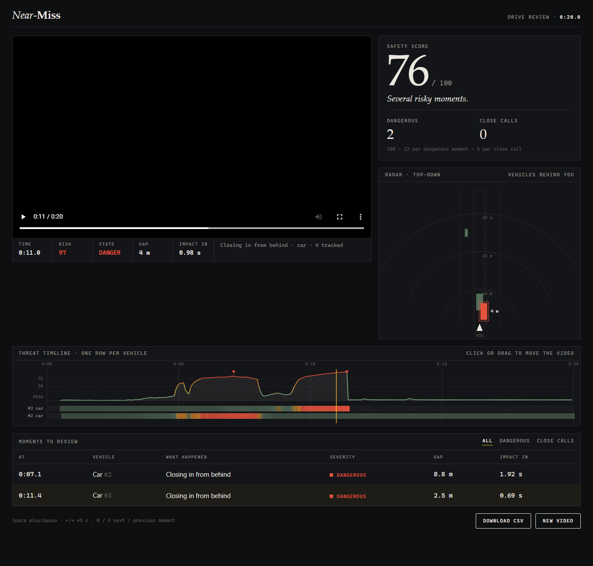
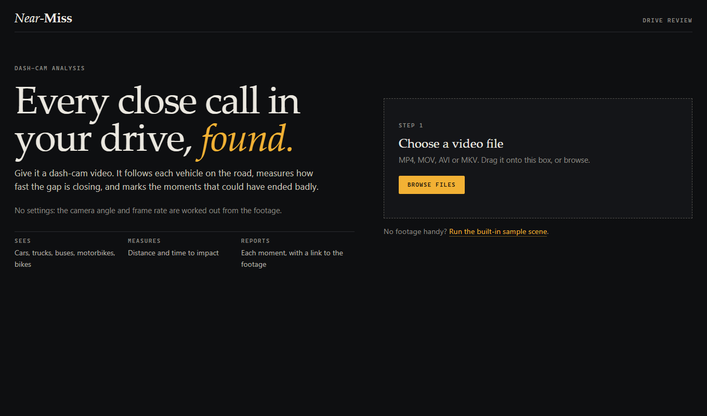
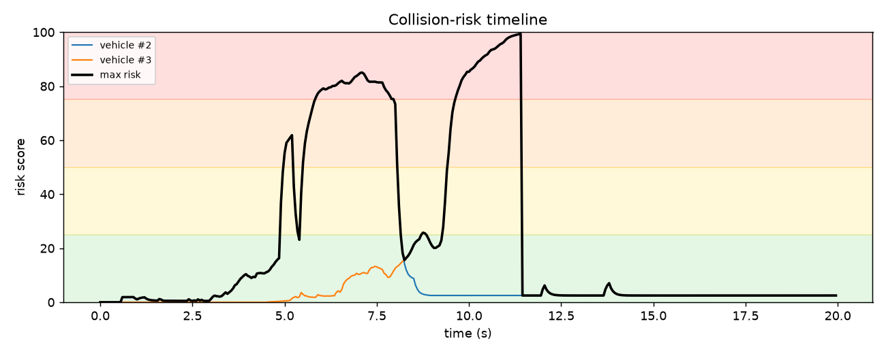

# Dashcam Near-Miss Detector

Finds the moments in a dash-cam video where another vehicle came dangerously close.

It detects vehicles with YOLOv8, follows them with a SORT-style tracker, estimates distance and closing speed from a single camera, predicts their path 3 seconds ahead, and gives every moment a collision-risk score from 0 to 100. A web app lets you review each event on the video, a risk timeline and a live top-down radar.



## Features

- **Detection and tracking:** YOLOv8n (pretrained COCO weights) for cars, trucks, buses, motorcycles and bicycles. A Kalman filter with IoU and Hungarian matching keeps each vehicle's identity.
- **Distance and speed from one camera:** pinhole model with assumed vehicle heights, smoothed by a second Kalman filter on road-plane position.
- **Time to collision:** world-based and looming-based estimates, blended.
- **Risk score and events:** a 0 to 100 score, mapped to Safe, Caution, Warning and Danger. Events are labelled cut-in, frontal, rear-end, or side left/right.
- **Automatic set-up:** the horizon is estimated from road lane lines and the frame step from the frame rate. No camera settings to enter.
- **Web app:** upload a video, watch it with a live readout, click the timeline or an event to jump to that moment. Includes a per-vehicle threat timeline and a CSV download.
- **Synthetic demo:** a rendered traffic scene with known answers, so the logic can be tested without any footage or model.

## Screenshots

| Landing page | Risk over time (demo scene) |
|---|---|
|  |  |

## Quick start (Windows)

Requires Python 3.10 or newer.

```powershell
git clone https://github.com/KALITH2006/dashcam-near-miss-detector.git
cd dashcam-near-miss-detector
python -m venv .venv
.venv\Scripts\python.exe -m pip install -r requirements.txt

.venv\Scripts\python.exe server.py        # web app at http://localhost:5000
```

Open http://localhost:5000, drop in a dash-cam video, or press "Run the built-in sample scene".

The first real video downloads `yolov8n.pt` (about 6 MB). `ultralytics` pulls in PyTorch, which is a large download. Analysis runs on the CPU by default, so a long video takes a while.

### Command line

```powershell
.venv\Scripts\python.exe main.py --demo                       # synthetic scene, no video needed
.venv\Scripts\python.exe main.py --source clip.mp4 --front-camera --hfov 90 --horizon 0.5 --cam-height 1.3 --stride 2
```

Each run writes `annotated.mp4`, `events.csv`, `tracks.csv`, `summary.json` and `risk_timeline.png` to the output folder (`outputs/` by default).

## How it works

```
video -> automatic set-up -> YOLOv8 -> tracker -> distance and speed filter -> TTC and path -> risk score -> events
```

| Stage | File | Method |
|---|---|---|
| Set-up | `calibrate.py` | Horizon from Hough lines (median vanishing point over 12 frames), frame step from fps |
| Detection | `detector.py` | Ultralytics YOLO, classes: bicycle, car, motorcycle, bus, truck |
| Tracking | `tracker.py`, `kalman.py` | Kalman on (cx, cy, w, h), IoU gate 0.2, Hungarian assignment, 4 hits to confirm |
| Distance | `risk.py` | `Z = f * H_real / h_px`, `X = (cx - W/2) * Z / f` |
| Motion | `risk.py` | Kalman on (X, Z) gives relative velocity. Noise grows with range |
| TTC | `risk.py` | `0.6 * (Z - L) / closing + 0.4 * h / (dh/dt)` |
| Prediction | `risk.py` | Constant velocity over 3 s |
| Risk | `risk.py` | `100 * (0.5 ttc + 0.2 dist + 0.3 path) * (0.5 + 0.5 path)`, smoothed |
| Events | `risk.py` | Risk at or above 50 for 6 updates in a row. Peak at or above 75 is "collision imminent" |
| Interface | `server.py`, `web/index.html` | Flask backend, single-page front end drawn on canvas |

Thresholds and weights are in `config.py`.

## Results so far

These come from runs on a synthetic scene and on a compilation of dash-cam near-miss clips. There is **no labelled ground truth yet**, so accuracy figures (hit rate, false alarms) have not been measured.

- **Synthetic scene (known answers):** both real threats are flagged (peak risk 85 and 99), and the two safe vehicles stay near zero.
- **Real clips:** the system produces many events. Spot checks on one clip confirmed two clear near-misses (a car pulling out about 6 m ahead, and a car turning across at about 3 m). Close pass-bys can also be flagged, and a few events were unclear.
- **Automatic horizon:** matched a hand-measured value on one clip (0.57).

## Limitations

- Distances come from assumed vehicle heights and a fixed field of view (90 degrees) and camera height (1.3 m), so they are rough, especially far away.
- No compensation for the ego vehicle's own motion. Swerving or braking shifts the whole image and distorts speed estimates.
- The tracker often loses and re-creates vehicles, so one car can appear under several IDs.
- Vehicles cut off by the frame edge give wrong distances, and a close pass beside the car can score as dangerous.
- Only cameras mounted on the vehicle (forward or rear) are suitable. Fixed CCTV and helmet cameras are not.
- Not tested on night footage or on a GPU.

## Project layout

```
main.py          command-line entry point
server.py        web app backend
web/index.html   web app front end
pipeline.py      video -> annotated video, CSV files, plot
calibrate.py     automatic camera set-up
detector.py      YOLO detector (and a simulated detector for the demo)
tracker.py       multi-object tracker
kalman.py        constant-velocity Kalman filter
risk.py          distance, TTC, path prediction, risk score, events
viz.py           drawing on the annotated video
demo_video.py    synthetic traffic scene with ground truth
config.py        all settings
```

## Ideas for next steps

1. Label near-miss times in a set of clips and report hit rate, false alarms per minute and detection delay.
2. Compensate for camera motion before computing vehicle speeds.
3. Compare world-only, looming-only and blended TTC.
4. Evaluate on a labelled public dataset such as BDD100K, DADA-2000 or Nexar.
5. Try larger YOLO models for small, distant vehicles and night footage.

## Data

No video is included in this repository. The test clips used during development were re-uploads from video sites and are not ours to redistribute. Use your own footage or a dataset with a suitable licence.

## Licence

No licence has been chosen yet. Until one is added, all rights are reserved by the author.
